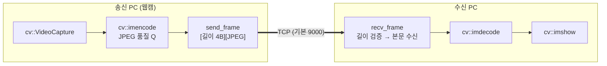

# OpenCV TCP Webcam Stream


웹캠 영상을 **JPEG로 압축해 TCP로 다른 PC에 실시간 전송**하고, 받는 쪽 화면에 띄우는 C++ 프로그램입니다.
외부 네트워크 라이브러리(Boost.Asio, Qt 등) 없이 **OS 기본 소켓 API**만으로 길이 헤더 기반 프레이밍 프로토콜을 직접 구현했습니다.



| 프로그램 | 역할 | 실행 위치 |
|---|---|---|
| `receiver` | TCP **서버**: 수신 → JPEG 복원 → 화면 표시 | 영상을 **보는** PC |
| `sender` | TCP **클라이언트**: 웹캠 캡처 → JPEG 압축 → 전송 | 웹캠이 **달린** PC |
| `test_protocol` | 프로토콜 단위 테스트 (웹캠·네트워크 불필요) | 아무 곳 |

## 프로토콜

프레임마다 `[4바이트 길이, 빅엔디안 uint32][JPEG 본문]`을 보냅니다.

```
 0      1      2      3      4 ...                       4+N
┌──────┬──────┬──────┬──────┬──────────────────────────────┐
│  N (big-endian uint32)    │  JPEG bytes (N bytes)        │
└──────┴──────┴──────┴──────┴──────────────────────────────┘
 예) N = 1234  →  00 00 04 D2
```

TCP는 바이트 **스트림**이라 `send` 한 번이 `recv` 한 번으로 오지 않습니다. 쪼개져 오기도 하고, 두 프레임이 붙어서 오기도 합니다.
그래서 길이 헤더로 프레임 경계를 표시하고, 정한 바이트 수를 끝까지 받을 때까지 반복합니다.

## 설계 포인트

모든 소켓 처리는 [`include/net_util.hpp`](include/net_util.hpp) 한 파일에 모았습니다.

- **부분 송수신 처리**: `send_all` / `recv_all`은 요청한 바이트를 모두 보내거나 받을 때까지 루프를 돕니다. `send`가 요청보다 적게 보내는 경우까지 처리합니다.
- **바이트 순서**: 길이는 `htonl` / `ntohl`로 네트워크 바이트 순서(빅엔디안)로 바꿉니다. CPU 엔디안이 달라도 호환됩니다.
- **손상 데이터 방어**: 길이가 0이거나 10 MB를 넘으면 `BadLength`로 거부합니다. 깨진 헤더 때문에 거대한 메모리를 할당하지 않습니다.
- **수신 결과 구분**: `recv_frame`의 결과를 `Ok` / `Closed`(상대가 정상 종료) / `BadLength` / `Error`로 나눠, 상황에 맞게 대응합니다.
- **SIGPIPE 방지**: 상대가 끊은 소켓에 `send`하면 프로세스가 SIGPIPE로 종료됩니다. `MSG_NOSIGNAL`을 줘서 `send`가 `-1`을 반환하게 하고, sender가 "전송 실패"를 출력한 뒤 스스로 종료하게 했습니다.
- **수신 측 복원력**
  - JPEG 한 장이 깨져도 길이 헤더 덕분에 다음 프레임 경계는 맞으므로, 그 장만 건너뛰고 계속 받습니다.
  - sender가 연결을 끊으면 receiver는 종료하지 않고 다음 연결을 기다립니다.
  - `SO_REUSEADDR`로 receiver를 재시작하면 바로 같은 포트를 다시 쓸 수 있습니다.
- **크로스 플랫폼 준비**
  - OS별 차이(소켓 타입, `close`/`closesocket`, SIGPIPE 유무)를 헤더 한 곳에서 흡수했습니다.
  - Windows의 `WSAStartup`/`WSACleanup`은 RAII 객체로 감쌌습니다.
  - Windows 분기는 작성만 했고 빌드·실행 검증은 하지 않았습니다.
- **사용성**
  - 1초마다 해상도, FPS, 평균 프레임 크기를 출력합니다.
  - sender는 `Ctrl+C`(SIGINT)를 받으면 정리하고 종료합니다.
  - `--local` 모드로 네트워크 없이 캡처와 JPEG 압축만 시험할 수 있습니다.
- **빌드 위생**: `-Wall -Wextra -Wpedantic`에서 경고 0건입니다. OpenCV는 필요한 모듈(core, imgcodecs, videoio, highgui)만 링크합니다. `compile_commands.json`을 만들어 IDE와 연동됩니다.

## 테스트

`test_protocol`은 `socketpair()`로 한 프로세스 안에 연결된 소켓 쌍을 만들어 **웹캠과 네트워크 없이** 프로토콜을 검증합니다.
큰 프레임은 소켓 버퍼(수백 KB)를 넘기 때문에, 보내기를 별도 스레드에서 실행해 실제 부분 송수신 상황을 재현합니다.

| 항목 | 검사 내용 |
|---|---|
| 길이 인코딩 | `1234 → 00 00 04 D2`, `0x01020304 → 01 02 03 04` (최상위 바이트가 먼저) |
| 왕복 | 1 B / 1 KB / 100 KB / **3 MB** 프레임을 보내고 받아 원본과 바이트 단위로 일치하는지 |
| 프레임 경계 | 10 B와 20 B 프레임을 연속으로 보냈을 때 따로 복원되는지 |
| 오류 처리 | 길이 0 → `BadLength`, 10 MB+1 → `BadLength`, 상대 종료 → `Closed`, 닫힌 소켓에 send → SIGPIPE 없이 `false` |
| 실제 JPEG | 그라데이션 이미지를 JPEG로 왕복 → 바이트 일치 + `imdecode`로 320x240 복원 |

```
$ ./build/test_protocol
...
PASS: 모든 검사 통과
```

## 빌드

**환경**: Ubuntu 24.04 · g++ 13 · CMake 3.28 · OpenCV 4.6에서 확인했습니다.

```bash
sudo apt install build-essential cmake libopencv-dev

git clone https://github.com/pth6254/opencv-tcp-webcam-stream.git
cd opencv-tcp-webcam-stream

cmake -S . -B build
cmake --build build
./build/test_protocol      # 마지막 줄에 "PASS"가 나오면 정상
```

## 실행

### 한 PC에서 시험

```bash
./build/receiver 9000                 # 터미널 1
./build/sender 127.0.0.1 9000         # 터미널 2
```

### 두 PC

두 PC가 같은 네트워크(같은 공유기나 Wi-Fi)에 있어야 합니다.

```bash
# 수신 PC
ip -4 -br addr                 # 내 IP 확인 (예: 192.168.0.13)
sudo ufw allow 9000/tcp        # 방화벽이 켜져 있으면 포트 열기
./build/receiver 9000

# 송신 PC (웹캠 연결)
./build/sender 192.168.0.13 9000
```

### 옵션

```
receiver [포트=9000] [--save 파일]          --save: 종료 시 마지막 프레임 저장
sender <서버IP> [포트=9000] [--cam N] [--quality Q] [--frames K]
sender --local [카메라번호]                  네트워크 없이 캡처/JPEG만 시험 → frame_test.jpg
```

| 옵션 | 기본값 | 설명 |
|---|---|---|
| `--cam N` | 0 | 카메라 번호 (`/dev/videoN`) |
| `--quality Q` | 80 | JPEG 품질 0–100. 낮출수록 프레임이 작아져 느린 네트워크에서 유리 |
| `--frames K` | 0 | K장 보내고 종료 (0 = `Ctrl+C`까지 계속) |

### 종료

- **receiver**: 영상 창을 **클릭해 선택**한 뒤 **영문 입력 상태**에서 `q` 또는 `ESC`를 누릅니다. 한글 입력 상태면 `q`가 `ㅂ`으로 들어가 인식되지 않습니다. 연결을 기다리는 중에는 `Ctrl+C`로 끝냅니다.
- **sender**: `Ctrl+C`로 끝냅니다. receiver가 먼저 꺼지면 "전송 실패"를 출력하고 스스로 종료합니다.

## 문제 해결

| 증상 | 확인할 것 |
|---|---|
| `연결 실패` | receiver가 먼저 켜져 있는지, IP가 맞는지, 수신 PC 방화벽(`sudo ufw allow 9000/tcp`) |
| `bind() 실패` | 같은 포트를 다른 프로그램이 쓰는 중 → 다른 포트 사용 |
| `카메라 0번을 열 수 없습니다` | `ls /dev/video*`로 번호 확인 후 `--cam 1` 등 지정 |
| 영상이 끊기거나 느림 | `--quality 50`으로 용량 줄이기, Wi-Fi 대신 유선 사용 |
| `QSocketNotifier: ...` 메시지 | OpenCV의 Qt 창이 내는 경고로, 동작에는 영향 없음 |

## 파일 구조

```
.
├── CMakeLists.txt         sender / receiver / test_protocol 빌드 설정
├── include/
│   └── net_util.hpp       소켓 공통 함수 (send_all / recv_all / send_frame / recv_frame, OS 차이 흡수)
└── src/
    ├── sender.cpp         송신 (TCP 클라이언트): 웹캠 → JPEG → 전송
    ├── receiver.cpp       수신 (TCP 서버): 수신 → JPEG 복원 → 화면 표시
    └── test_protocol.cpp  프로토콜 단위 테스트 (socketpair + 스레드)
```

## 한계와 개선 아이디어

- 연결 하나에 프레임을 순서대로 보내는 구조라, 네트워크가 느리면 지연이 쌓입니다. 최신 프레임만 보내는 프레임 드롭 정책이나 UDP 전송으로 개선할 수 있습니다.
- receiver는 sender 하나만 받습니다(`listen` 대기열 1).
- 암호화와 인증이 없으므로 신뢰할 수 있는 로컬 네트워크에서만 사용하세요.

## 라이선스

[MIT License](LICENSE)
